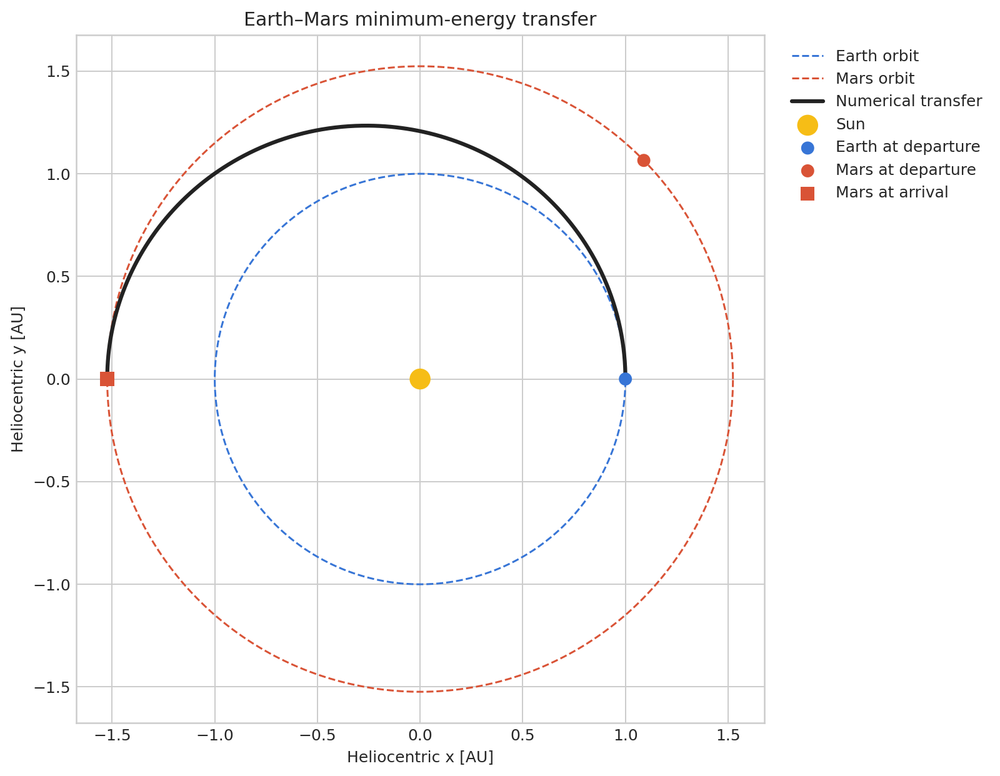
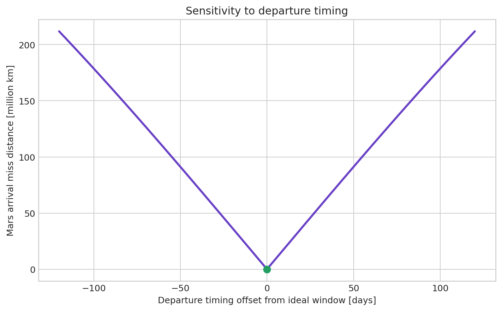
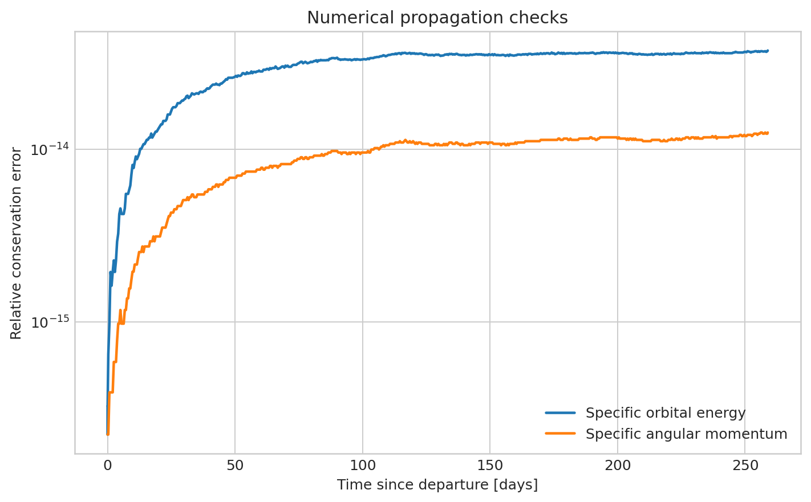
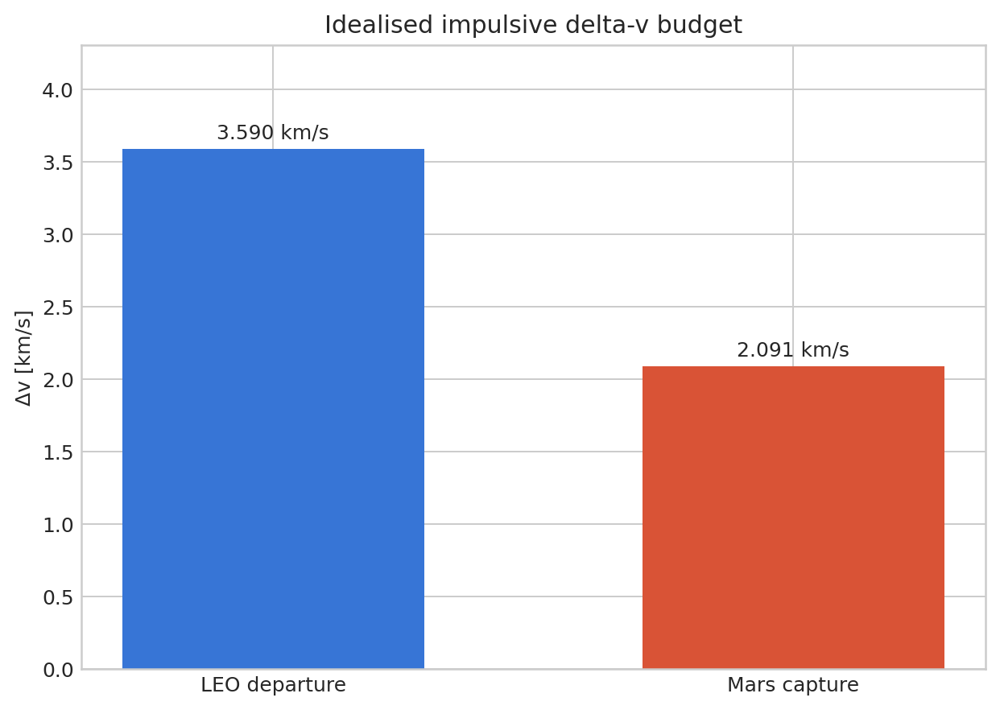

# Earth--Mars Orbital and Trajectory Analysis


An analysis-focused astrodynamics project calculating and validating a
minimum-energy Earth-to-Mars transfer. The project uses MATLAB for the
mathematics, numerical propagation and visualisation; it does **not** build a
software application.

## Questions answered

- How long does an ideal Hohmann transfer from Earth to Mars take?
- Where must Mars be relative to Earth at departure?
- What hyperbolic-excess speeds are required at each planet?
- What impulsive delta-v is required from a 300 km LEO and for capture into a
  300 km circular Mars orbit?
- Does numerical propagation reproduce the analytic intercept?
- How sensitive is the intercept to departure timing?

## Key results

| Quantity | Result |
|---|---:|
| Transfer time | **258.87 days** |
| Required Mars phase angle | **44.34 degrees ahead of Earth** |
| Earth departure `v_inf` | **2.945 km/s** |
| Mars arrival `v_inf` | **2.649 km/s** |
| 300 km LEO departure burn | **3.590 km/s** |
| 300 km Mars capture burn | **2.091 km/s** |
| Total idealised impulsive delta-v | **5.681 km/s** |
| Earth--Mars synodic period | **779.95 days** |

## Visual results

### Heliocentric trajectory



### Departure-timing sensitivity



### Numerical conservation checks



### Idealised delta-v budget



## Method

1. Calculate the analytic Hohmann ellipse using circular, coplanar mean
   planetary orbits.
2. Use vis-viva to obtain heliocentric speeds and planetary hyperbolic-excess
   velocities.
3. Use patched conics to estimate departure from LEO and capture at Mars.
4. Propagate the Sun-centred transfer with `ode45`.
5. Check arrival position, specific orbital energy and angular momentum.
6. Sweep departure timing around the ideal phase geometry.

The complete derivation, assumptions and interpretation are in
[the technical report](report/technical_report.md). A concise
[learning and interview guide](report/learning_guide.md) explains how to
present the project in your own words.

## Run in MATLAB

From the repository root:

```matlab
run_analysis
```

Generated files are written to `results/`.

Run the reference tests with:

```matlab
runtests('tests')
```

## Repository structure

```text
run_analysis.m                     Main entry point
src/earth_mars_transfer_analysis.m Calculations, propagation and figures
src/two_body_rhs.m                 Two-body differential equation
tests/test_reference_values.m      Checks against analytic reference values
report/technical_report.md         Derivation, results and limitations
report/learning_guide.md           Short walkthrough and interview prompts
results/                           Numerical outputs and figures
```

## CV description

> Analysed an idealised Earth--Mars Hohmann transfer in MATLAB, deriving the
> launch phase angle, transfer duration, hyperbolic-excess velocities and
> patched-conic delta-v budget; validated the trajectory with numerical
> two-body propagation and orbital-conservation checks.

## Scope and limitations

This is an educational first-order mission study. Circular and coplanar
planetary orbits, impulsive burns and patched conics deliberately keep the
analysis transparent. It does not include dated ephemerides, launch-site
geometry, finite burns, mid-course corrections or a Lambert solver.

## Data sources

- [JPL Solar System Dynamics astrodynamic parameters](https://ssd.jpl.nasa.gov/astro_par.html)
- [NASA/JPL Earth--Mars launch-window lesson](https://www.jpl.nasa.gov/edu/resources/lesson-plan/lets-go-to-mars-calculating-launch-windows/)
- [NASA Basics of Space Flight: Trajectories](https://science.nasa.gov/learn/basics-of-space-flight/chapter4-1/)

